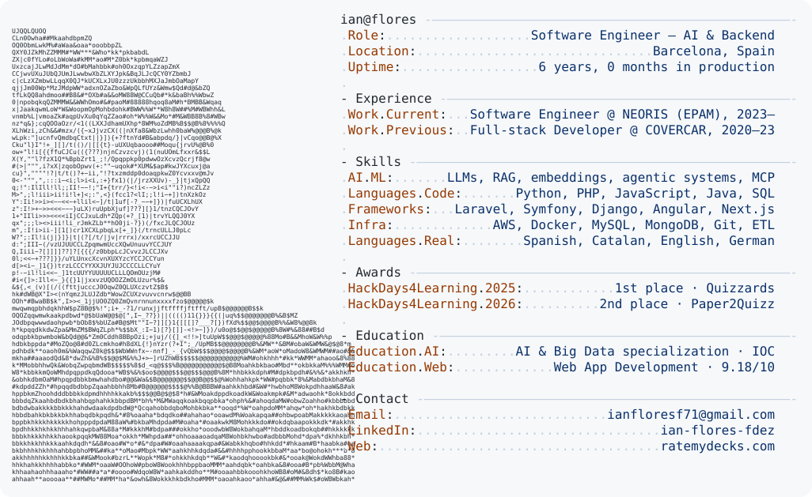

<a href="https://github.com/ianfloresfdez/ianfloresfdez">
  <picture>
    <source media="(prefers-color-scheme: dark)" srcset="https://raw.githubusercontent.com/ianfloresfdez/ianfloresfdez/main/dark_mode.svg">
    
  </picture>
</a>

### Software Engineer — AI & Backend · Barcelona

5+ years shipping production backends (Python, PHP/Laravel, Symfony), now focused on taking **LLM systems to production**: RAG, embeddings, agents, MCP and MLOps.
Currently at **NEORIS (EPAM)**. 🏆 1st place HackDays4Learning 2025 · 2nd place 2026 (backend lead).

**Open to AI / ML Engineer roles** → [LinkedIn](https://www.linkedin.com/in/ian-flores-fdez) · ianfloresf71@gmail.com

#### Featured work

| Project | What it does | Stack |
|---|---|---|
| [jobscout-mcp](https://github.com/ianfloresfdez/jobscout-mcp) | MCP server for tech job hunting: searches job boards, reads the market and ranks offers against your skills | TypeScript · MCP |
| [rag-mlops-project](https://github.com/ianfloresfdez/rag-mlops-project) | End-to-end RAG API: document ingestion, vector search and grounded answers with local LLMs, tracked with MLflow | Python · FastAPI · ChromaDB · LangChain · Docker |
| [ratemydecks.com](https://ratemydecks.com) | AI product (live) that evaluates Magic: The Gathering decks, detects card synergies and suggests improvements | Next.js · LLMs |

Also building (private, happy to demo): an **OpenAI-compatible LLM gateway** with routing, fallback, semantic cache and cost metrics (Helm, kind, CI); an **evaluation harness for LLM agents** with golden sets, LLM-as-judge and a CI regression gate; and a **code-graph MCP server** that feeds local LLMs only the relevant context of a repo.
